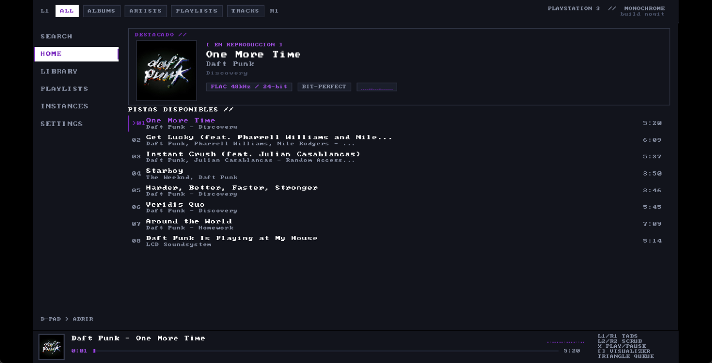
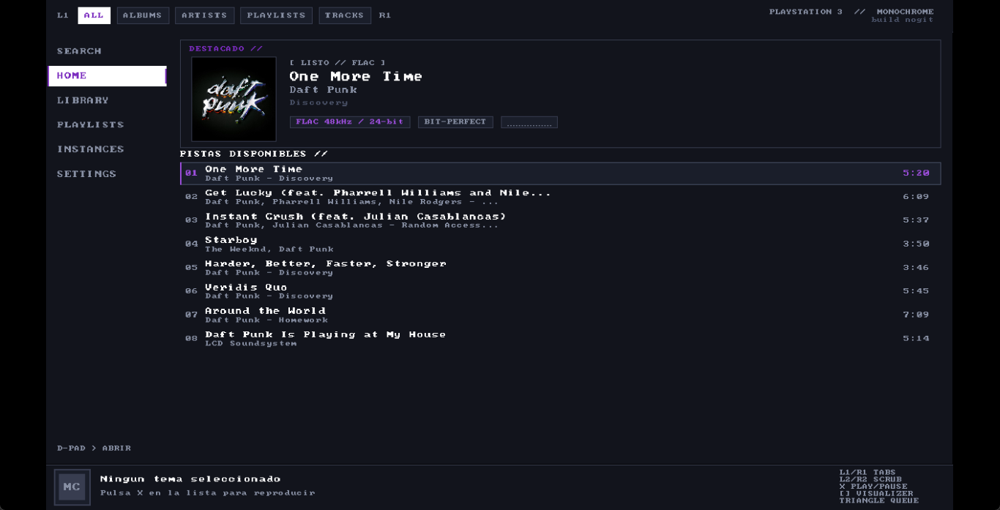
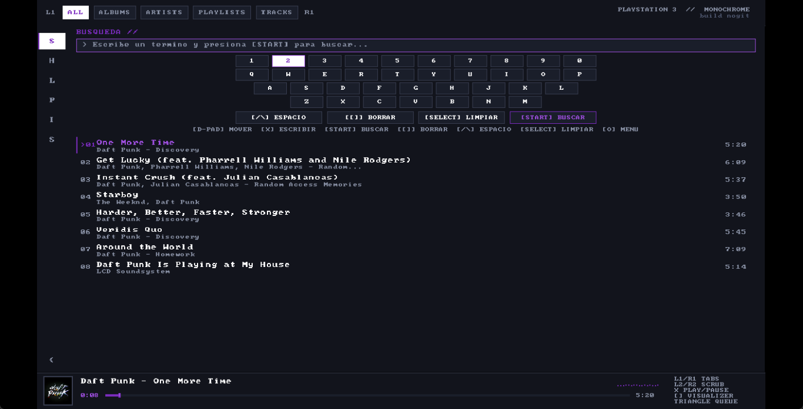
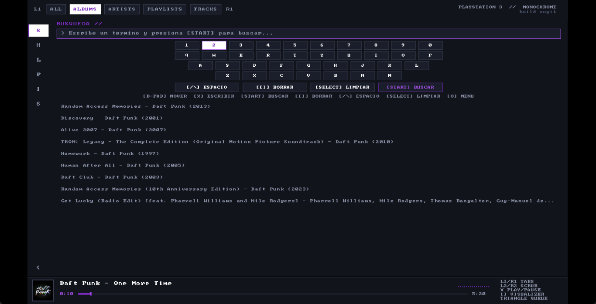
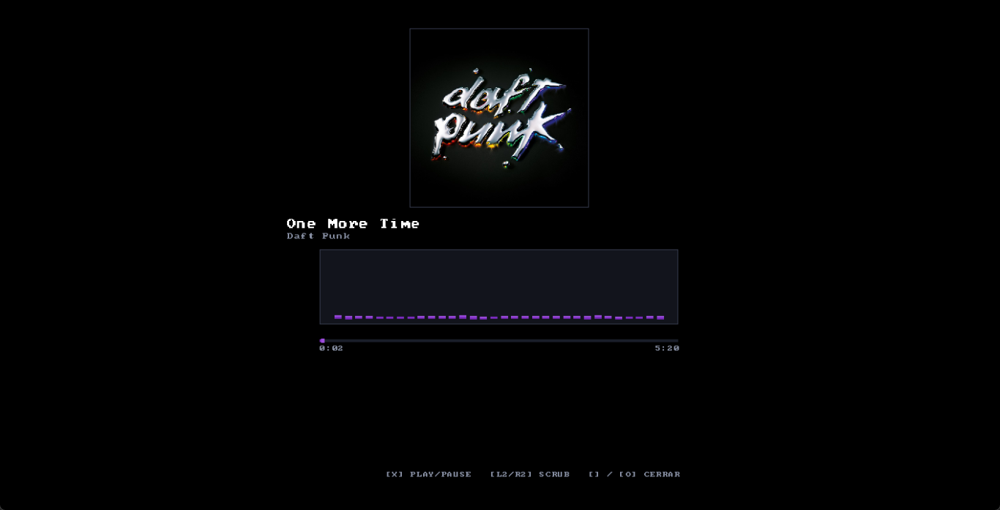
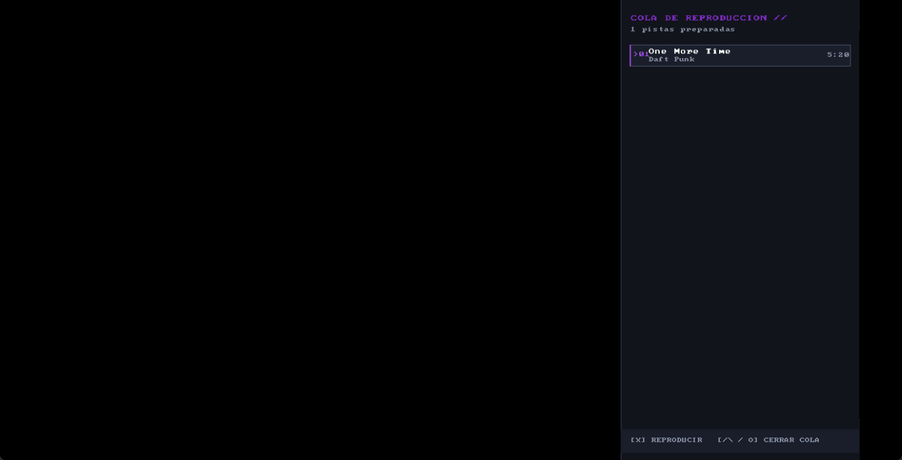
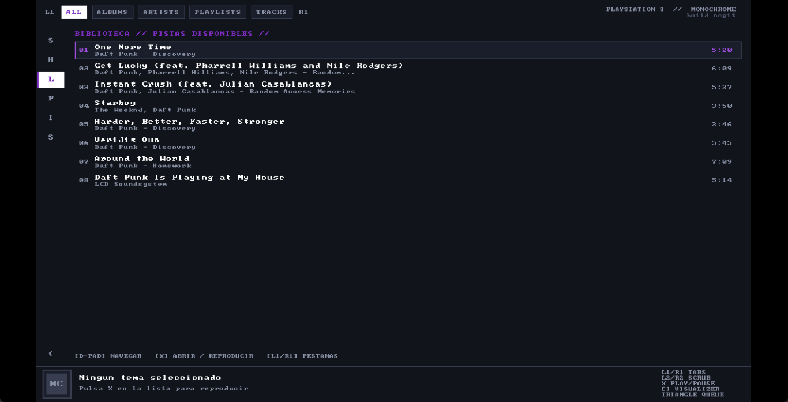
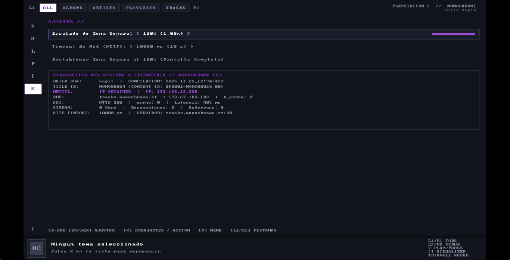

# Monochrome PS3

<p align="center">
  
</p>

<p align="center">
  <strong>Title ID:</strong> <code>MONO00024</code> &nbsp;|&nbsp;
  <strong>Categoría XMB:</strong> Música (<code>AM</code>) &nbsp;|&nbsp;
  <strong>Versión:</strong> <code>v2.4.11</code> &nbsp;|&nbsp;
  <strong>Plataforma:</strong> PlayStation 3 (CFW / PS3HEN) &amp; RPCS3
</p>

**Monochrome PS3** es un reproductor nativo de música en streaming sin pérdida (*FLAC lossless*) diseñado desde cero para PlayStation 3, con interfaz acelerada por hardware (RSX / Tiny3D) y control completo desde el DualShock 3.

> Proyecto fuente completo en [`monochrome-ps3-2.4.0/`](monochrome-ps3-2.4.0/) · Notas de lanzamiento en [`RELEASE_NOTES.md`](monochrome-ps3-2.4.0/RELEASE_NOTES.md)

---

# Parte 1 · Guía para Usuarios

## ¿Qué ofrece Monochrome PS3?

- **Audio FLAC en tiempo real**: reproduce música sin compresión destructiva directamente en tu PS3 (compatible con pistas de calidad estándar y Hi-Res).
- **Integración en la columna Música del XMB**: se instala bajo el Title ID `MONO00024` con categoría `AM`, apareciendo directamente en el apartado **Música** del menú principal de PS3.
- **Interfaz v3 limpia y rápida a 60 FPS**: barra lateral de secciones (*Search, Home, Library, Playlists, Instances, Settings*), pestañas superiores (`ALL`, `ALBUMS`, `ARTISTS`, `PLAYLISTS`, `TRACKS`), reproductor inferior fijo con carátula, cola lateral y visualizador a pantalla completa.
- **Caché local inteligente**: almacena pistas recientes en disco para reanudar o repetir sin volver a descargar, limpiando automáticamente las más antiguas al alcanzar su límite.
- **Ajuste de pantalla (Overscan / Zona Segura)**: adapta el tamaño de la interfaz directamente desde **Settings** si tu televisor recorta los bordes.

---

## Galería (Tiny3D v3)

<p align="center">
  
  
</p>
<p align="center">
  
  
</p>
<p align="center">
  
  
</p>
<p align="center">
  
</p>

---

## Instalación en PlayStation 3

1. Descarga el archivo `monochrome_ps3.pkg` (o `MONO00024_v2.4.11.pkg`) desde la sección **Releases**.
2. Cópialo a la raíz de un USB en formato FAT32 o a `/dev_hdd0/packages/` por FTP (webMAN MOD / multiMAN).
3. En la PS3 (con **PS3HEN** activado o **CFW**), entra en *Administrar archivos PKG → Instalar archivos PKG* e instala el paquete.
4. Abre **Monochrome Music Player** desde la columna **Música** del XMB. *(Si ya tenías instalada una versión previa en la columna Juego, reinicia el XMB o reinstala el `.pkg` para refrescar la categoría.)*

---

## Controles (DualShock 3)

| Botón | Función |
|---|---|
| **D-Pad Arriba / Abajo** | Navegar por pistas, álbumes, artistas, playlists, cola o menú lateral |
| **D-Pad Izquierda / Derecha** | Moverse entre el contenido y el menú lateral izquierdo / ajustar valores en Ajustes |
| **Cruz (`✕`)** | Reproducir o pausar pista / abrir álbum, artista o playlist / confirmar tecla |
| **Círculo (`○`)** | Volver al menú lateral izquierdo / salir del drill-down o cerrar modales |
| **L1 / R1** | Cambiar pestaña superior (`ALL` · `ALBUMS` · `ARTISTS` · `PLAYLISTS` · `TRACKS`) |
| **L2 / R2** | Adelantar o retroceder (`-5%` / `+5%`) dentro del visualizador |
| **Triángulo (`△`)** | Abrir / cerrar la cola de reproducción (en Buscar inserta un espacio) |
| **Cuadrado (`□`)** | Abrir / cerrar el visualizador a pantalla completa (en Buscar borra un carácter) |
| **START** | Ejecutar búsqueda (en Buscar) / Play-Pause rápido en el resto de pantallas |
| **SELECT** | Limpiar texto de búsqueda (en Buscar) |
| **Botón PS** | Salida limpia e inmediata al XMB |

---
---

# Parte 2 · Especificaciones Técnicas y Arquitectura

## 1. Capa de Red HAL (`net_hal`) y Cliente HTTP/JSON

Implementado en [`include/net_hal.h`](monochrome-ps3-2.4.0/include/net_hal.h), [`source/net_hal.c`](monochrome-ps3-2.4.0/source/net_hal.c), [`source/http_client.c`](monochrome-ps3-2.4.0/source/http_client.c) y [`source/cJSON.c`](monochrome-ps3-2.4.0/source/cJSON.c) sobre **PSL1GHT v2** (`libnet` + `libnetctl` + `libsysmodule`):

- **Gestión de enlace e inicialización idempotente**: carga `SYSMODULE_NET` y `SYSMODULE_NETCTL`, monitoriza el estado de red (`NET_HAL_DISCONNECTED`, `NET_HAL_CONNECTING`, `NET_HAL_IP_OBTAINED`, `NET_HAL_ERROR`) e integra caché DNS con TTL de 60 s protegida con mutex (`sysMutexAttrInitialize`).
- **E/S no bloqueante compatible con PSL1GHT**: sockets TCP configurados con `O_NONBLOCK` / `SO_NBIO` e inspeccionados mediante `poll()` (`<net/poll.h>`) en cortes de ≤250 ms. Se evita explícitamente `select()`/`FD_SET` porque en PSL1GHT los descriptores llevan `SOCKET_FD_MASK = 0x40000000`, excediendo `FD_SETSIZE`.
- **Worker de búsqueda persistente (`mono_search`)**: hilo dedicado sincronizado por `sysCond` + mutex, cancelación cooperativa, validación de IDs (`[A-Za-z0-9_-]`, longitud `1..63`), codificación URL RFC 3986 y seguimiento acotado de redirecciones HTTP.
- **Parser JSON endurecido (`cJSON`)**: profundidad máxima acotada (`CJSON_MAX_DEPTH = 64`), guardas contra punteros nulos y decodificación segura de pares subrogados UTF-16.
- **Telemetría y logging rotativo**: registro thread-safe en `/dev_hdd0/tmp/mono_stage6.log` (rotación a 2 MB) y métricas en tiempo real (`NetHalTelemetry`: IP, DNS, código HTTP, `errno`, `h_errno`, latencia API, bitrate del stream, reconexiones y underruns) visibles en **Settings**.

## 2. Subsistema de Audio Lossless (`audio_engine`)

Implementado en [`source/audio_engine.c`](monochrome-ps3-2.4.0/source/audio_engine.c) sobre GameOS `libaudio` + `dr_flac`:

- **Salida DMA nativa**: 2 canales estéreo Float32 LPCM a **48.000 Hz**, sincronizados por eventos hardware (`audioCreateNotifyEventQueue` / `audioSetNotifyEventQueue`).
- **Planificación de hilos LV2**: hilo consumidor DMA (`mono_hw`) en prioridad de tiempo real junto a worker de streaming HTTP (`mono_stream`, descarga en `750`), desacoplados por un ring buffer de PCM y buffer circular de descarga.
- **Resiliencia de flujo FLAC**: prebuffer inicial (`PREBUFFER_THRESHOLD = 2 MB`), recepción no bloqueante con `SO_RCVBUF` ampliado, reanudación automática mediante `HTTP 206 Range` ante cortes TCP/timeout y downsampling automático de pistas Hi-Res (`44.1 kHz -> 48 kHz` polifásico y `88.2/96/192 kHz`).
- **Caché en HDD**: almacenamiento persistente en `/dev_hdd0/tmp/monochrome/cache/` acotado automáticamente (`CACHE_MAX_FILES = 25`, `CACHE_MAX_BYTES = 512 MB`) con expulsión LRU/antigüedad.

## 3. Motor Gráfico RSX / Tiny3D y UI v3

Implementado en [`source/gfx_tiny3d.c`](monochrome-ps3-2.4.0/source/gfx_tiny3d.c), [`source/rsxutil.c`](monochrome-ps3-2.4.0/source/rsxutil.c), [`source/cover_art.c`](monochrome-ps3-2.4.0/source/cover_art.c) y `monochrome-ps3-2.4.0/source/ui_*.c`:

- **Renderizado Tiny3D sobre RSX**: contexto GCM con `HOST_SIZE = 8 MB` y buffer de comandos `CB_SIZE = 1 MB` ([`include/rsxutil.h`](monochrome-ps3-2.4.0/include/rsxutil.h)), lienzo lógico `1920×1080` con escalado subpíxel tipográfico y calibración de zona segura persistida en `/dev_hdd0/game/MONO00024/USRDIR/config.cfg`.
- **Subsistema asíncrono de carátulas (`cover_art.c`)**: descarga JPEG en segundo plano, decodificación con `libjpeg` aislada mediante `setjmp`/`longjmp` ante imágenes truncadas o corruptas y carga en texturas RSX.
- **Arquitectura desacoplada de estado (`app_state.c`)**: estado puro sin llamadas gráficas (`AppContext`), cola real de reproducción, historial reciente, mapeo uniforme de pestañas (`app_state_get_tab_items`) y drill-down asíncrono para álbumes, artistas y playlists.

## 4. Ciclo de Vida, Empaquetado y Compilación

- **Binario y metadatos SFO**: `SYS_PROCESS_PARAM(1001, 0x100000)` en [`source/main.c`](monochrome-ps3-2.4.0/source/main.c), salida limpia al XMB mediante `sysUtilRegisterCallback` / `sysUtilCheckCallback`, Title ID unificado `MONO00024` y categoría `AM` (Música) definida en [`sfo.xml`](monochrome-ps3-2.4.0/sfo.xml) e inyectada en [`Makefile`](monochrome-ps3-2.4.0/Makefile) vía `SFOXML := $(CURDIR)/sfo.xml`.
- **Compilación oficial (Docker `ghcr.io/altps3/ps3dev:latest`)**:

```powershell
cd monochrome-ps3-2.4.0
powershell -NoProfile -ExecutionPolicy Bypass -File tools/run_in_docker.ps1
```

O directamente dentro del contenedor:

```bash
cd monochrome-ps3-2.4.0 && docker run --rm -v "${PWD}:/src" -w /src ghcr.io/altps3/ps3dev:latest bash -c "make clean && make pkg"
```
