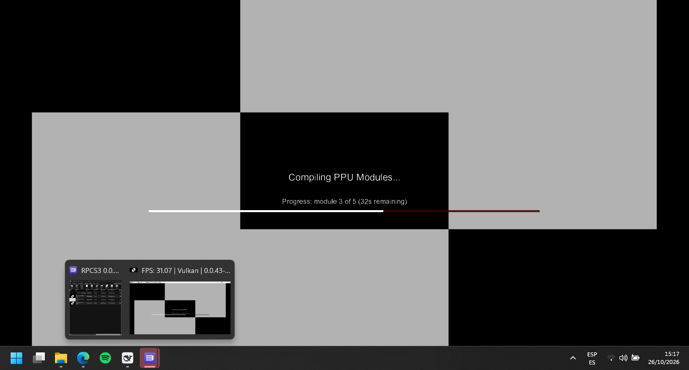
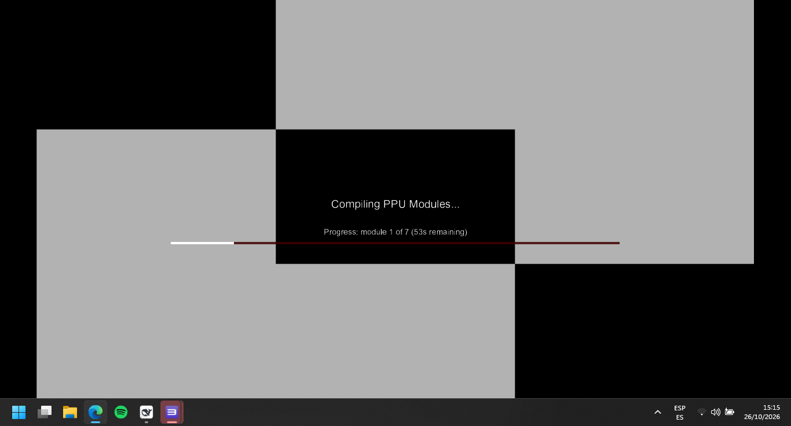
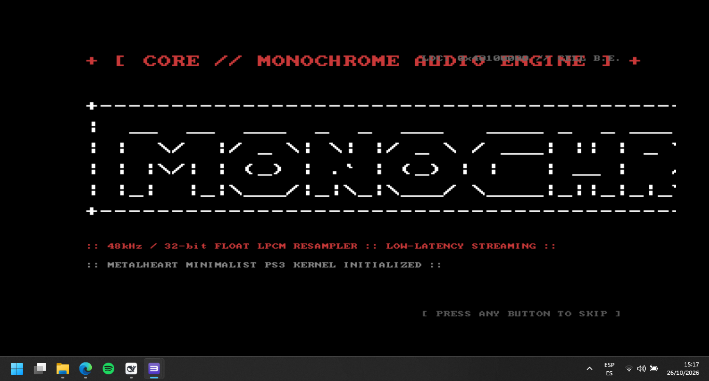

# Monochrome PS3 — Technical Specification (v2.3.0)

PlayStation 3 native music streaming engine built with the **PSL1GHT v2** open-source toolchain for the Cell Broadband Engine and RSX Reality Synthesizer.

---

## 📸 Screenshots

| Now Playing (Artwork & Real-Time Spectrum) | Music Library & Navigation (`v2.3.0`) |
|:---:|:---:|
|  |  |

| On-Screen Keyboard (OSK) Search |
|:---:|
|  |

---

## ⚙️ Especificaciones Técnicas de la Arquitectura

### 1. Subsistema de Audio (GameOS Audio DMA)
- **Modo de Salida**: 2 canales estéreo Float32 LPCM nativos a 48.000 Hz.
- **Hardware DMA Synchronization**: Manejo de eventos hardware mediante `audioCreateNotifyEventQueue` + `audioSetNotifyEventQueue` y polling con `sysEventQueueReceive` (timeout 25 ms).
- **Consumo de Hardware**: 256 samples por bloque (5.33 ms por interrupción DMA) escritos directamente en el offset del bloque destino (`dest = audioDataStart + write_block * blockSize`).
- **Prioridad de Hilos LV2**:
  - Hilo Consumidor DMA (`mono_hw`): Prioridad de tiempo real **100** (64 KB stack), asegurando 0 underruns de hardware.
  - Hilo de Pipeline / Decodificador (`mono_stream`): Prioridad cooperativa **1000** (128 KB stack).
- **Decodificación FLAC**: Decodificador progresivo `dr_flac` con callbacks personalizados no bloqueantes (`flac_stream_read`, `flac_stream_seek`, `flac_stream_tell`).
- **Resampling Polifásico Lineal**: Conversión exacta 147:160 para flujos a 44.1 kHz hacia 48.0 kHz nativos con preservación de continuidad en fronteras de bloque (`s_resample_boundary`).
- **Ring Buffer Intermedio**: Capacidad de 576.000 frames (12.0 segundos de búfer estéreo a 48 kHz).

### 2. Capa de Red y Streaming TCP (BSD Sockets / libnet)
- **Protocolo**: HTTP/1.1 persistente hacia `tracks.monochrome.st:80`.
- **Configuración de Socket**: `SO_RCVBUF` ajustado a 512 KB para evitar estancamiento de ventana TCP en flujos Hi-Res de alto bitrate (hasta 96 kHz / 24-bit).
- **Recepción No Bloqueante**: Consumo concorrente mediante `recv(..., MSG_DONTWAIT)` dentro del bucle de decodificación para prevenir bloqueos del pipeline.
- **Estrategia de Prebuffer**: Umbral mínimo de 4 MB de flujo FLAC crudo verificado antes del inicio de reproducción.
- **Manejo de Respuestas HTTP 429**: Algoritmo de backoff exponencial configurable (hasta 8 reintentos: 3s, 6s, 12s, 24s, 48s, 60s).
- **Caché Persistente en Disco**: Persistencia atómica en `/dev_hdd0/tmp/monochrome/tracks/<id>.flac`.

### 3. Subsistema Gráfico y Presentación (RSX Reality Synthesizer)
- **Contexto de Comando**: RSX GCM context asignado en memoria de host XDR (`0x40100000`, 32 MB IO mapping).
- **Resolución y Formato**: 1920×1080 nativo, 32-bit XRGB (8.294.400 bytes por buffer de visualización).
- **Estrategia de Buffer**: Doble buffer en RSX Local Memory con sincronización vertical `gcmSetFlipMode(GCM_FLIP_VSYNC)`.
- **Ajuste de Geometría de Pantalla**:
  - Offset horizontal y vertical con precisión de 1 píxel.
  - Factor de escala con precisión flotante de 0.005 (`0.50` a `1.50`).
  - Factor de escala tipográfica con precisión de 0.02.
  - Persistencia en archivo binario/texto `/dev_hdd0/tmp/monochrome/screen_config.txt`.

### 4. Empaquetado y Metadatos de Sistema
- **Binario de Ejecución**: ELF64 compilado con `ppu-gcc`, enlazado con `-mcpu=cell` y empaquetado como CEX SELF NPDRM.
- **Title ID**: `MONO00024`.
- **Versión PARAM.SFO**: `02.30`.
- **Estructura PKG Free NPDRM**:
  - `ICON0.PNG`: 320×176 píxeles, formato PNG RGBA.
  - `PIC1.PNG`: 1920×1080 píxeles, formato PNG RGBA oscuro de alto contraste.
  - `USRDIR/EBOOT.BIN`: SELF firmado para ejecución en OFW/HFW PS3HEN y CFW Cobra.

---

## 🎮 Mapeo de Entradas (DualShock 3 / ioPad)

| Código de Entrada | Botón Físico | Función en Sistema |
|---|---|---|
| `ACT_UP` / `ACT_DOWN` | D-Pad Arriba / Abajo | Navegación de listas / Desplazamiento vertical (Screen Adjust: ±1px) |
| `ACT_LEFT` / `ACT_RIGHT` | D-Pad Izquierda / Derecha | Navegación horizontal / Desplazamiento horizontal (Screen Adjust: ±1px) |
| `ACT_CROSS` | Cruz (✕) | Selección / Play / Pause |
| `ACT_CIRCLE` | Círculo (○) | Retorno / Cancelar / Salir de submenú |
| `ACT_SQUARE` | Cuadrado (□) | Conmutar a teclado en pantalla (`STATE_SEARCH`) |
| `ACT_TRIANGLE` | Triángulo (△) | Conmutar a cola de pistas (`STATE_QUEUE`) |
| `ACT_L1` / `ACT_R1` | Gatillos L1 / R1 | Pista anterior / siguiente \| Escala de fuente (Screen Adjust: ±0.02) |
| `ACT_L2` / `ACT_R2` | Gatillos L2 / R2 | Escala de visualización (Screen Adjust: ±0.005) |
| `ACT_START` | Botón START | Abrir menú de opciones / Guardar configuración de pantalla |
| `ACT_SELECT` | Botón SELECT | Restablecer configuración de pantalla a valores de fábrica |

---

## 🛠️ Pipeline de Compilación

```bash
docker run --rm -v "${PWD}:/src" ghcr.io/altps3/ps3dev:latest bash -c "cd /src && make clean && make pkg"
```
