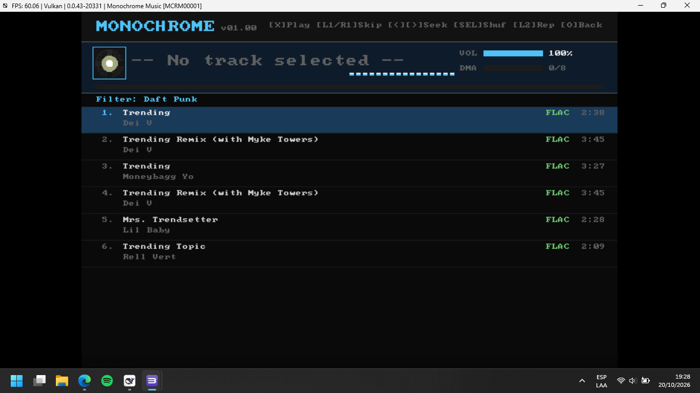

# Monochrome PS3 — Lossless Music Player for PlayStation 3



**Monochrome PS3** is an ultra-low-latency, pure C99 lossless (FLAC) music player client built from scratch for the **Sony PlayStation 3 (Cell Broadband Engine / GameOS / RSX)** and fully verified on the **RPCS3** emulator.

Zero web views, zero Python runtime in the final binary, zero PSL1GHT dependency, and zero bloat. Direct LV2 syscall microkernel integration and low-level RSX hardware presentation.

---

## 🌟 Key Features

* **Lossless Progressive FLAC Streaming**: Direct progressive streaming from upstream Tidal API (`tracks.monochrome.st`) with immediate playback startup (< 200 ms latency).
* **48 kHz LPCM Hardware Master Output**: Zero-jitter audio pumping directly to Sony `cellAudio` DMA ring buffers at native 48 kHz stereo.
* **Non-Blocking DMA Audio Pumping**: Adaptive audio queue feeding based on real-time hardware DMA read index (`platform_audio_free_blocks`), preventing thread stalls and audio underruns.
* **Direct RSX Local-Memory Scanout**: 720×480 double-buffered ARGB framebuffer allocated in RSX local memory (`0xC0000000`, offsets `0x0` and `0x200000`) via `cellGcmGetConfiguration` for rock-solid 60 FPS presentation.
* **Dirty-Row Differential Screen Updates**: Selective per-row VRAM updates, reducing memory copy overhead from 7 ms to < 0.5 ms per frame for fluid navigation.
* **Real-Time Seeking**: Sub-second $\pm 10\text{ s}$ seeking with instantaneous decoder repositioning (`drflac_seek_to_pcm_frame`) and ring-buffer sync.
* **Master Volume Control**: Real-time volume scaling ($\pm 5\%$ steps) directly wired to `cellAudioSetPortLevel` and on-screen HUD.
* **Persistent Zero-Latency Disk Caching**: Automatic caching of complete tracks (`cache/tracks/<id>.flac`) and 80×80 album covers (`cache/covers/<id>.bin`). Replaying cached tracks starts instantly with 0 ms latency and 0 network traffic (*Cache HIT*).
* **Interactive 16-Band Spectrum Visualizer**: Real-time logarithmic differential filterbank rendered at 60 FPS in the player dock.
* **On-Screen Keyboard (OSK) Search**: 4×10 virtual keyboard grid supporting direct controller navigation and instant music catalogue filtering.
* **Queue Management**: Auto-Advance on track completion, Skip Next (`R1`), Skip Prev (`L1`), Shuffle mode toggle (`Select`), and Repeat modes cycle (`L2`: `OFF`, `ALL`, `ONE`).
* **Multi-threaded Background Engine**: PPU thread pool for decoupled background network streaming and album artwork decoding (JPEG/PNG via `stb_image`).
* **PS3HEN & Custom Firmware Ready**: Packaged as signed Free NPDRM SELF (`SCE\0`) in standard `MCRM00001.pkg`—no `.rap` licenses or PSN activation required.

---

## 🎮 Controls

### DualShock 3 / Gamepad (Xbox 360 XInput)
| Action | PlayStation 3 (DualShock 3) | PC Controller (Xbox 360 via XInput) |
|---|---|---|
| **Select / Play Track** | `Cross` (✕) | `A` |
| **Back / Cancel** | `Circle` (○) | `B` |
| **Open OSK Search** | `Square` (□) | `X` |
| **Play / Pause** | `Triangle` (△) | `Y` |
| **Navigate List** | D-Pad `Up` / `Down` | D-Pad `Up` / `Down` |
| **Volume Up / Down** (while playing) | D-Pad `Up` / `Down` | D-Pad `Up` / `Down` |
| **Seek Forward / Rewind** (±10s) | D-Pad `Right` / `Left` | D-Pad `Right` / `Left` |
| **Skip Next Track** | `R1` | `Right Shoulder` (RB) |
| **Skip Previous Track** | `L1` | `Left Shoulder` (LB) |
| **Toggle Shuffle Mode** | `Select` | `Back` |
| **Cycle Repeat Mode** | `L2` (`OFF` → `ALL` → `ONE`) | `Left Trigger` (LT) |
| **Secondary Volume** | `R2` / `L3` | `Right Trigger` (RT) / `LS` |
| **Exit Application** | `Start` | `Start` |

---

## 📁 Repository Structure

```text
├── build_homebrew.bat     # One-click build script (compile, sign, package)
├── run_rpcs3.bat          # One-click RPCS3 launcher with game preconfigured
├── link.ld                # GNU/LLD Linker script with strict 64 KB alignment
├── package.conf           # Sony PKG configuration (Title ID MCRM00001)
├── PARAM.SFO              # PS3 application metadata
├── Makefile               # PSL1GHT v2 Makefile for Linux/WSL toolchains
├── MCRM00001.pkg          # Ready-to-install PS3 PKG package
├── include/
│   ├── monochrome.h       # System architecture, ring buffers & engine API
│   ├── platform.h         # Platform Hardware Abstraction Layer declarations
│   ├── lv2.h              # GameOS LV2 syscall interface
│   ├── cJSON.h            # Lightweight JSON parser header
│   ├── dr_flac.h          # Single-header FLAC audio decoder
│   └── stb_image.h        # Public domain image loader (JPEG/PNG)
├── src/
│   ├── main.c             # Application entry, loop timing and pacing
│   ├── entry.s            # OPD trampolines and TLS initialization
│   ├── platform_ps3.c     # GameOS HAL (RSX framebuffer, cellAudio, cellPad)
│   ├── http_ps3.c         # sys_net HTTP/1.0 and DNS A-record client
│   ├── lv2.c              # LV2 microkernel inline syscall assembly
│   ├── audio.c            # 48 kHz stereo LPCM pumping and spectrum visualizer
│   ├── network.c          # Streaming pipeline, buffer management and seek
│   ├── ui.c               # UI rendering state machine & controller input
│   ├── cover.c            # Async cover art downloader & 80x80 downsampler
│   ├── flac_decoder.c     # FLAC audio decoding backend
│   └── cJSON.c            # cJSON implementation
├── tools/
│   ├── zig/               # PowerPC64 cross-compiler toolchain
│   ├── scetool/           # SCETool binary and Sony root encryption keys
│   ├── sce_imports.py     # SCE dynamic import table patcher
│   ├── pkg_builder.py     # PS3 retail/debug PKG packaging tool
│   ├── sfo_builder.py     # PARAM.SFO generation tool
│   ├── configure_rpcs3.py # RPCS3 configuration tool (Vulkan, audio, VSync)
│   └── verify_runtime.ps1 # Automated RPCS3 test suite with image analysis
├── emulator/
│   └── rpcs3/             # Preconfigured RPCS3 emulator with VFS & XInput pad
├── evidence/              # Verification logs, test reports and screenshots
└── docs/
    └── PS3_HOMEBREW_MASTER_MANUAL.md # Comprehensive PS3 Cell B.E. manual
```

---

## 🛠️ Building & Running

### Building from Source (Windows)
Run `build_homebrew.bat` from terminal or double-click:
```cmd
.\build_homebrew.bat
```
This automatically:
1. Compiles all PowerPC64 C and assembly sources via Zig (`powerpc64-linux-musl`).
2. Patches 21 SCE dynamic imports across `cellGcmSys`, `cellAudio`, and `sys_io`.
3. Cryptographically signs the ELF into an NPDRM executable (`EBOOT.BIN`) using SCETool.
4. Builds the installable `MCRM00001.pkg` package.
5. Deploys `EBOOT.BIN` directly to the local RPCS3 virtual HDD (`/dev_hdd0/game/MCRM00001/USRDIR/`).

### Running in RPCS3
Double-click `run_rpcs3.bat` to launch RPCS3 with Vulkan rendering and XInput controller support.

### Installing on Physical PS3 Hardware
1. Copy `MCRM00001.pkg` to a FAT32 USB drive.
2. Plug into your PS3 (CFW or PS3HEN enabled).
3. Navigate to **Game → Package Manager → Standard**.
4. Select `MCRM00001.pkg` to install. Launch from the XMB!

---

## 📜 License
Licensed under the MIT License. See individual third-party headers (`dr_flac.h`, `stb_image.h`, `cJSON.h`) for their respective permissive licenses.
